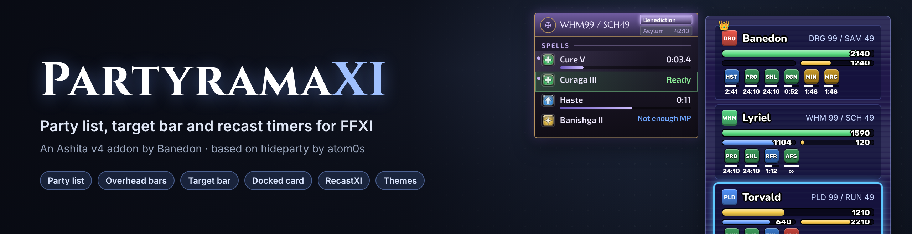
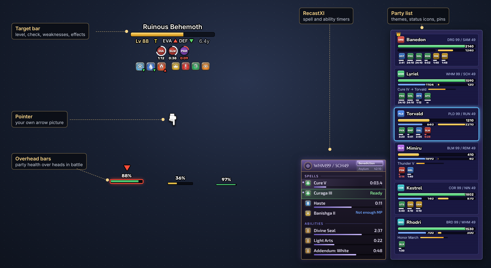
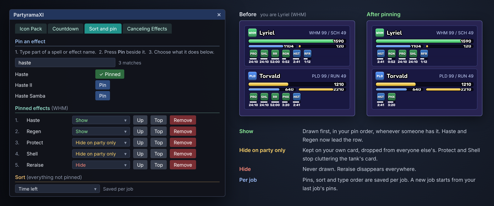
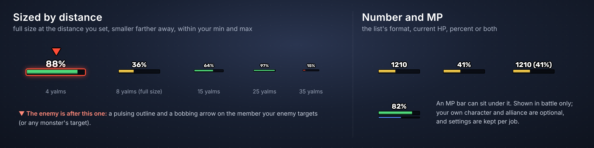
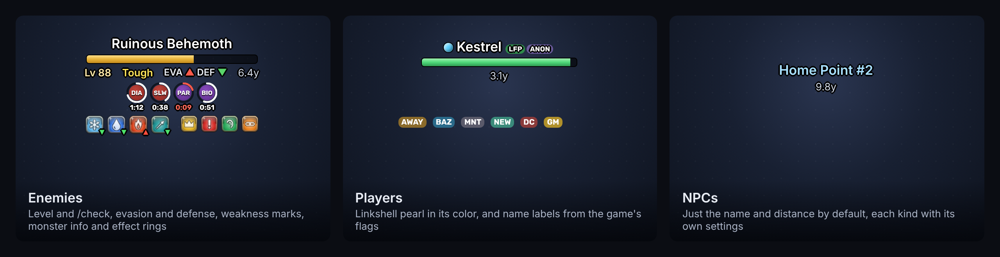
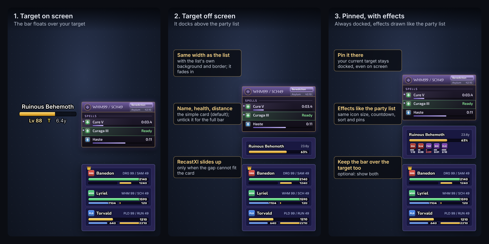
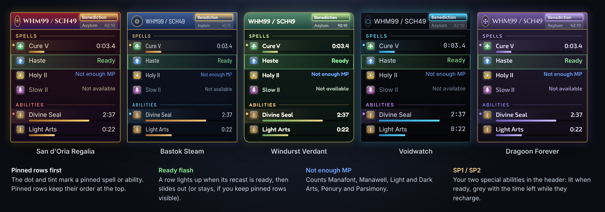
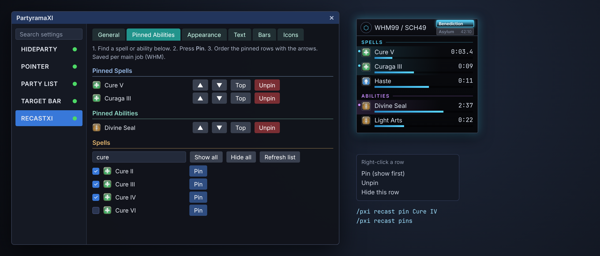
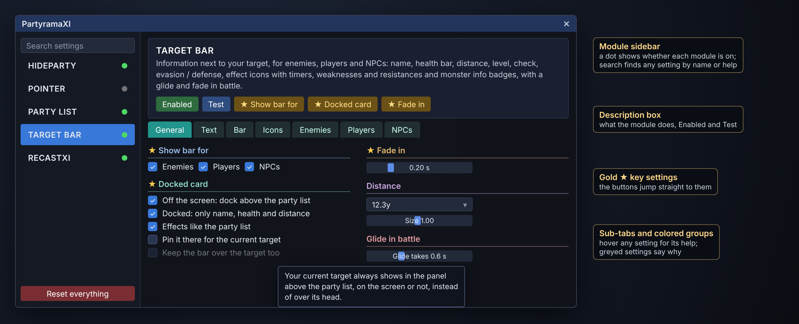

# PartyramaXI

**A party list, target bar and recast timers for Final Fantasy XI on Ashita v4.**

By **Banedon**. Based on **hideparty** by atom0s (Ashita Development Team), the addon that hides the game's party windows.

PartyramaXI hides the game's party, alliance and target windows and draws its own: a themed party list with status timers you can pin, health bars over your party in battle, a target bar with level, check, weaknesses and effect timers that docks above the list when the target is off screen, and **RecastXI** spell and ability timers built in. Every part can be switched on or off, and everything is set up in game.

> The pictures on this page are mockups drawn with the addon's own icons, fonts and theme colors. Status icons show as plain colored tiles here; in game they use whatever icon pack you install.

---

## Install (TL;DR)

1. Click **Code > Download ZIP** on this page (or grab the latest release) and unzip it.
2. Copy the `partyramaxi` folder from inside it into your Ashita addons folder, so you have `Ashita/addons/partyramaxi/partyramaxi.lua`.
3. **Unload hideparty** if you use it.
4. In game: `/addon load partyramaxi`
5. To load it every time, add `/addon load partyramaxi` to `Ashita/scripts/default.txt`.
6. Type `/pxi config` to open the settings. `/pxi test` shows samples of everything, so you can set it up anywhere.

The first load starts from ready-made settings, made on a 3840 x 2160 screen and fitted once to smaller screens. Settings are saved per character.

---

## Features

| | |
| --- | --- |
| **Party and alliance list** | Themed cards with job icon, name, job, HP / MP / TP bars, current action and cast bar |
| **17 list themes + Custom** | Drawn themes, picture-framed themes, or your own picture as the background |
| **Status icons with timers** | Countdowns for effects the addon saw land, kept through zoning and reloads. Click your own to cancel |
| **Pinning** | Pick which effects come first, which are hidden, and which show only on your own card. Saved per job |
| **Overhead bars** | Health bars over your party's heads in battle, sized by distance, with a mark on whoever the enemy is after |
| **Target bar** | Enemies, players and NPCs each with their own settings: level, /check, evasion and defense, effect rings |
| **Weaknesses and monster info** | Elements, damage types and status effects from MobDB (if installed) or built-in LandSandBoat data, plus NM, aggro, link and detection badges |
| **Docked card** | When your target leaves the screen, it docks above the party list. Pin it there if you like it there all the time |
| **RecastXI** | Spell and ability recasts in five themes, with Pinned Abilities, a Ready flash, Not enough MP and SP1 / SP2 badges |
| **Pointer** | Your own arrow over the target and sub-target: a hand, a dagger, drawn shapes or any picture |
| **Hideparty** | Hides the game's party, alliance, target and cast info windows, each on its own |
| **Settings window** | Module sidebar with search, gold ★ key settings, help on every setting, Test buttons |

---

## Party list

Each member gets a card with their job icon, name, job and level, HP / MP / TP bars, what they are casting and their status effects. Click a card, or bind keys to `/pxi list next` and `/pxi list prev`, to select a member. Selecting also targets them, and if the game is waiting for a target (a spell sent with `<stpc>`), selecting casts it on them.

### Themes

- **Drawn themes:** Aurora, Gilded, Frost, Ember, Sakura, Slate Corners, Midnight, Vana'diel Blue, Steel, Verdant, Crimson and Minimal.
- **Picture-framed themes:** Classic Scanline, Vana'diel Gradient, Dusk, Smoke and Void, built from the frames in `backgrounds/`.
- **Custom:** start from any theme and change anything: background color, gradient or picture, border, cards, bar colors and finish, fonts. The default look is Custom with the `Window1-bg.png` picture.
- **Assume RecastXI Theme** gives the list the same frame as your recast window, so the two match.
- `/pxi list theme <name>` switches theme from the chat line.

Bars have their own tab: colors by health level, size, gloss, trails when HP drops, and where the numbers sit. **Edit positions** lets you drag any part of a card with the mouse and fine-tune it by the pixel.

### Pinning status effects

Pinning chooses which status icons come first on the cards, and which ones you never want to see. Open **Party List > Icons > Sort and pin**:

1. Under **Pin an effect**, type part of a name, for example `haste`, `protect` or `sleep`.
2. Press **Pin** beside the one you want. It joins **Pinned effects**, set to **Show**.
3. Choose what it does:
   - **Show:** drawn first, in your pin order, whenever someone has it.
   - **Hide:** never drawn on any card.
   - **Hide on party only:** drawn on your own card, but not on the other members' cards.
4. Use **Up** and **Top** to order your pins, and **Remove** to unpin.

**Sort** decides the order of everything that isn't pinned: game order, last applied first, time left, or by type of magic in an order you choose. Pins, sort and the type order are saved **per job**, and a job you haven't set up yet starts with your last job's choices.

### Overhead bars

In battle, each party member on screen gets a small health bar over their head.

- **Sized by distance:** full size at the distance you choose, smaller farther away and larger up close, within your minimum and maximum.
- **Who the enemy is after:** a pulsing outline and a bobbing arrow on the member your enemy is targeting (or any monster's target, if you choose).
- **The number:** the list's format, current HP, percent or both. An MP bar can sit under it.
- Your own character and alliance members are optional. Settings are kept **per job**, so your tank and healer setups can differ.

---

## Target bar

The target bar sits next to your target. Enemies, players and NPCs each have their own tab, so an NPC can show just a name while a monster shows everything.

- **Name, health and distance**, for every kind of target.
- **Level and /check:** the target is checked for you, and the replies are kept out of your chat log. The result reads as short (EP, DC, T...), spelled out, or both. Notorious monsters and battlefield enemies that can't be gauged show `??`.
- **Evasion and defense** from the check, as up and down marks.
- **Effect icons** on the target, with countdown rings or bars.
- **Weaknesses and resistances:** elements, damage types and status effects. A green mark pointing down means it takes more, a red mark pointing up means it resists. With the **MobDB** addon installed its numbers are used; otherwise the LandSandBoat data built into PartyramaXI is used. Marks can also show as percentages.
- **Monster info badges:** notorious monster, aggressive, links, how it detects you (sight, sound, scent, magic, low HP, true sight) and more. With MobDB installed, hover over them for the whole card: family, job, respawn, drops, steal and spells.
- **Players:** the linkshell pearl in its color, and labels such as LFP, ANON, AWAY, BAZ, MNT, NEW and GM.
- **In battle** the bar can glide aside and fade parts out, so it doesn't sit on the fight.
- **Sub-target:** while you pick a sub-target, its card slides up or down off your target's card instead of overlapping it, with a gap you set.
- Icon styles for elements and badges: jewel, flat, painted, glyph, high contrast and glass, or a folder of your own.

### Docking and pinning the target

1. **On screen**, the bar floats over the target as usual.
2. **Off screen**, the target docks as a card above the party list, as wide as the list and in its frame. It fades in, and RecastXI slides up only if the gap can't fit the card. By default the card keeps to name, health and distance; untick that to see everything the bar shows.
3. **Pin it there for the current target** keeps your target docked even when it's on screen. **Keep the bar over the target too** shows both.

With **Effects like the party list** on, the effects on the docked target are drawn like the party list's status icons, with the same countdown look, sort and pins. They wrap into more rows so every icon stays inside the card, and the card has its own **Card icon size** and **Countdown on the card icons** switch. These live in **Target bar > General > Docked card**.

---

## RecastXI

Spell and ability recast timers, built in. Attach the window above the party list or place it on its own.

- **Five themes:** San d'Oria Regalia, Bastok Steam, Windurst Verdant, Voidwatch and Dragoon Forever (Drachen or Wyrm palette), each with its own fonts, crest, header texture and bar style.
- **Ready flash:** a row lights up when its recast is ready, then slides out.
- **Not enough MP** replaces the timer on a spell you can't afford right now. The cost counts Manafont, Manawell, Light Arts, Dark Arts, Penury and Parsimony.
- **SP1 / SP2 badges** in the header: lit when ready, grey with the time left while they recharge.
- **When it shows:** in cutscenes or not, out of battle or not, and what to do when nothing is on recast.
- Element and magic type icons, effects level, outer glow, fonts and sizes.

### Pinned Abilities

Pinned Abilities chooses which spells and abilities the recast window shows, and which come first. Open **RecastXI > Pinned Abilities**, or type `/pxi recast pinned`.

1. Find a spell or ability in the **Spells** or **Abilities** list. **Search** narrows both.
2. Press **Pin**. It moves into **Pinned Spells** or **Pinned Abilities**, and pinned rows always come first.
3. Order them with the arrows, **Top** or **Unpin**.
4. The tick box beside each row shows or hides it. **Show all** / **Hide all** change every row that matches the search.

Shortcuts: right-click a row in the recast window for **Pin (show first)**, **Unpin** or **Hide this row**, or type `/pxi recast pin Cure IV`. Each main job has its own list, or tick **Separate profile per sub job** to set up WHM/RDM and WHM/SCH apart.

---

## Pointer and Hideparty

- **Pointer:** your own arrow over the target and sub-target, where the game puts its arrow or over the character's head. A pointing hand (default), a dagger, a triangle, a chevron, a rotating crystal, or any PNG you drop into `icons/arrows/`. Size, colors, outline, turn and bob or pulse animation.
- **Hideparty:** hides the game's party window, alliance parties 2 and 3, the target window and the spell / ability info window, each on its own. Everything comes back when the addon is unloaded.

---

## The settings window

`/pxi config` opens it.

- **Module sidebar:** Hideparty, Pointer, Party List, Target Bar and RecastXI. A dot shows whether each one is on. The search box finds any setting by its name or help text, in every module.
- **Description box:** what the module does, its **Enabled** button and its **Test** button.
- **Gold ★ key settings:** the settings that matter most, with buttons that jump straight to them.
- **Sub-tabs and colored groups:** hover over any setting for its help, and point at a group to highlight the part of the screen it changes. A greyed-out setting says why it doesn't apply right now.
- **Reset everything** puts every module back to the ready-made settings.

Changes apply straight away and are saved automatically.

---

## Commands

`/pxi` and `/partyramaxi` do the same thing. `/pxi help` and `/pxi recast help` list everything.

| Command | What it does |
| --- | --- |
| `/pxi config` | Open the settings |
| `/pxi test` | Show samples of everything for a few seconds |
| `/pxi list next` / `prev` | Select the next / previous party member (bind keys to these) |
| `/pxi list theme <name>` | Switch the party list theme |
| `/pxi buffs` | Open the status icon cursor with the keyboard (bind a key) |
| `/pxi hide` / `show <window>` | Choose which game windows are hidden |
| `/pxi recast pinned` | Open Pinned Abilities |
| `/pxi recast pin <name>` / `unpin <name>` | Pin or unpin a spell or ability |
| `/pxi recast theme <name>` | Switch the RecastXI theme |
| `/pxi info` | Show what was found and what is being drawn |

The full guide, with every command and every folder, is in [partyramaxi/README.md](partyramaxi/README.md).

---

## Pictures, fonts and icon packs

- **No icon packs are included.** Drop any status icon pack (for example HXUI's `0.png` .. `639.png`) into `icons/packs/<Pack>/` and pick it in the settings. Anything without a picture gets a drawn tile, so nothing breaks.
- Element, damage type, monster badge and magic type icons come in several styles; add a folder of your own to make another.
- Extra `.ttf` / `.otf` fonts go in `fonts/` and appear in every font list. Rubik, Nunito and the RecastXI theme fonts are included.
- Party list backgrounds go in `backgrounds/`.

---

## Credits

**PartyramaXI and RecastXI** by Banedon.

- **hideparty** by atom0s, Ashita Development Team: PartyramaXI started from hideparty, and its window hiding is based on it. Thank you to atom0s and the Ashita team for Ashita itself.
- **Windower Resources** (Windower Team, BSD license): spell and status names and durations.
- **Debuffed** by Xathe: the approach for tracking effects on the target.
- **LandSandBoat** (GPL v3): spell effects, monster levels, weaknesses and info.
- **MobDB** by ThornyFFXI: its data files are read for weaknesses when it is installed. MobDB itself is not included.
- **XIUI** by Velyn: the signatures used to detect events and a hidden interface.
- **Fonts** are Google Fonts under the SIL Open Font License 1.1.
- Game icons and names belong to Square Enix. Icon packs belong to their authors.

## License

GNU General Public License v3.0 or later. See [LICENSE](LICENSE). Free to use, change and share; please keep the license and these credits.
